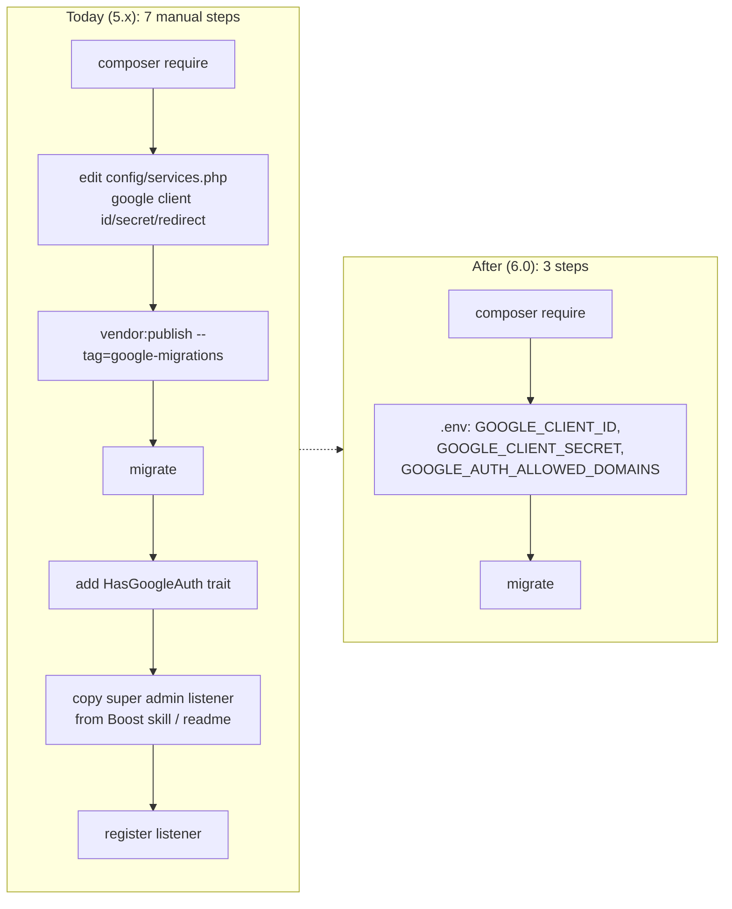
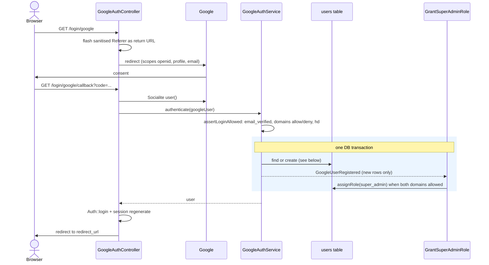
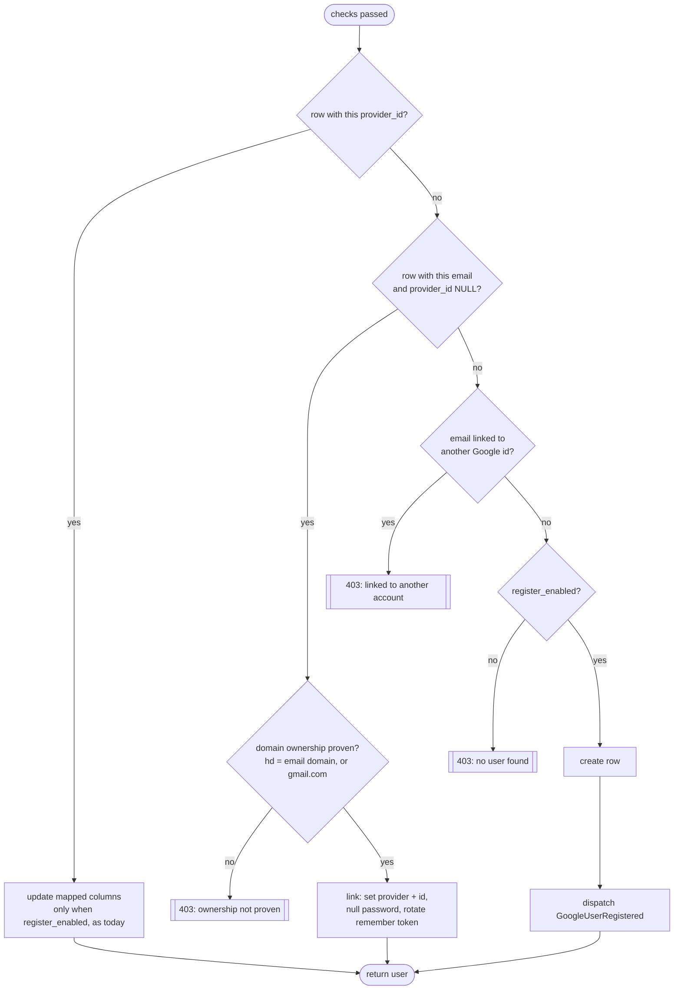
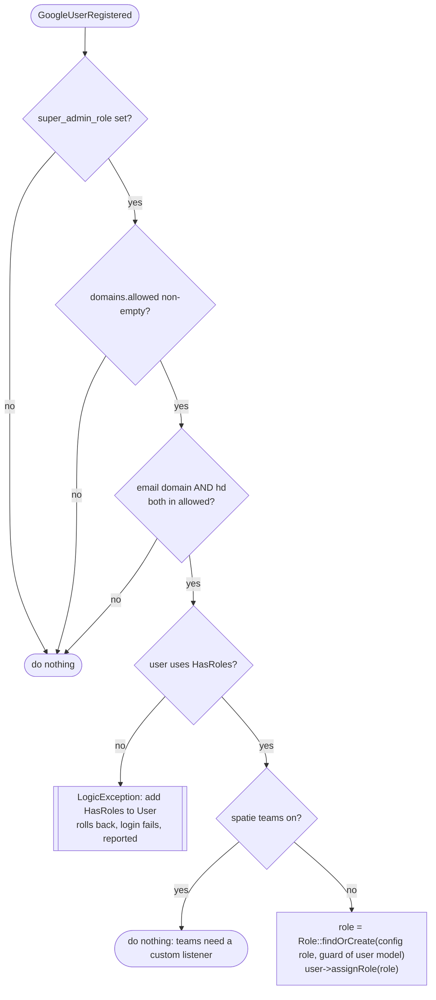

# Rework plan: lean, zero-config Google login (v6.0)

Status: **draft, waiting for approval** · Branch: `feature/rework-plan` · Date: 2026-11-10

## Goal

`composer require statikbe/laravel-google-authenticate`, set three env vars, run `migrate`, and Google login works.
Out of the box, a new Google user from an allowed Workspace domain gets the super admin role through a listener that ships with the package, so projects stop copying the `GrantSuperAdminToOrganisation` listener from the Boost skill.

**Hard rule: no Google-auth code in the project.** The package owns everything: routes, controller, checks, migration, the super admin grant, the super admin gate and the domain guard. The only project code allowed is an optional custom listener (section 6.1). The only project-side setup is configuration (env vars) and spatie's own `HasRoles` trait on the User model, which every spatie project has already.

The package keeps every current behaviour: domain allow/deny lists, the `hd` check, verified email, safe linking of existing rows, `register_enabled`, `remember`, `user_columns`, custom middleware, the `GoogleUserRegistered` event and the return-URL guard.

## 1. Install today vs after



For the super admin role, spatie is optional: install `spatie/laravel-permission`, migrate its tables and add `HasRoles` to User. Most Statik projects already have this through Filament Shield. Without spatie, login works and no role is granted. See [decision D1](#4-decisions-to-confirm).

## 2. File structure, before and after

```mermaid
flowchart LR
    subgraph Before["5.x"]
        direction TB
        b1["src/GoogleAuthenticateController.php"]
        b2["src/GoogleAuthenticateServiceProvider.php"]
        b3["src/Services/GoogleAuthService.php"]
        b4["src/Events/GoogleUserRegistered.php"]
        b5["src/Exceptions/GoogleAuthenticationException.php"]
        b6["src/Traits/HasGoogleAuth.php"]:::del
        b7["src/config/google-authenticate.php"]
        b8["src/routes.php"]
        b9["database/migrations/...stub (publish only)"]
        b10["resources/views/auth/* (never loaded)"]:::del
        b11["resources/lang/en/messages.php"]
    end
    subgraph After["6.0"]
        direction TB
        a1["src/Http/GoogleAuthController.php"]
        a2["src/GoogleAuthenticateServiceProvider.php"]
        a3["src/GoogleAuthService.php"]
        a4["src/Events/GoogleUserRegistered.php"]
        a5["src/Exceptions/GoogleAuthenticationException.php"]
        a6["src/Listeners/GrantSuperAdminRole.php"]:::new
        a12["src/Facades/GoogleAuthenticate.php"]:::new
        a7["config/google-authenticate.php"]
        a8["routes/web.php"]
        a9["database/migrations/..._add_google_provider_to_users_table.php<br/>(auto-loaded, idempotent)"]
        a11["resources/lang/en/messages.php"]
    end
    classDef del fill:#fdd,stroke:#c33,color:#600
    classDef new fill:#dfd,stroke:#3a3,color:#060
```



| File | Change | Why |
|---|---|---|
| `src/Traits/HasGoogleAuth.php` | **delete** | The service sets `provider`/`provider_id` with `forceFill`, so the `getFillable` override does nothing. Overriding `getFillable` also hides the model's own fillable logic. |
| `resources/views/auth/*` | **delete** | `loadViewsFrom` is commented out. Nothing uses the views. The `google-views` publish tag goes too. |
| `src/Services/GoogleAuthService.php` | move to `src/`, slim down | Remove the hardcoded `App\Models\User` (it breaks apps with a different user model). Merge `findOrCreate` + `createUser` into one lookup flow (section 3). Replace the `GOOGLE_VALUES` loop with one `data_get` per value. |
| `src/GoogleAuthenticateController.php` | move to `src/Http/` | Move `guest` middleware to the route. Call `report()` on unexpected `Throwable`s, so a broken listener shows up in logs instead of a silent "something went wrong". Redirect with `redirect()->intended(redirect_url)`, so a user sent to login from a protected page lands back there. That was the main reason projects wrote their own controller. |
| `src/config/...` | move to `config/` | Laravel package convention. Add env defaults (section 5). |
| `src/routes.php` | move to `routes/web.php` | Convention. Routes get `guest` middleware. |
| migration stub | `loadMigrationsFrom`, anonymous class, `hasColumn` guards | `migrate` picks it up without publishing. Guards skip columns that a published 5.x migration already added. Still publishable for apps that want to edit it. |
| `src/Listeners/GrantSuperAdminRole.php` | **new** | Default listener, section 6. The role grant sits in its own `protected assignRole()` method, so another role library only overrides that method (D11). |
| `src/Facades/GoogleAuthenticate.php` | **new** | Facade over `GoogleAuthService` (bound as a singleton). Exposes the domain check, so project code (policies, Filament `canAccessPanel()`, seeders) reuses the package rule instead of copying it (D10). |
| `composer.json` | `spatie/laravel-permission` `^6.0\|^7.0` in `suggest` and `require-dev`, drop Laravel 10 and the `doctrine/dbal` suggest | D1 and D2. |

Expected size: about 700 lines of PHP today, about 400 after, with no behaviour lost.

## 3. Login flow (unchanged security, one code path)



Find-or-create, merged into one flow. Today it is two near-duplicate paths that depend on `register_enabled`:



## 4. Decisions to confirm

| # | Question | Recommendation | Trade-off |
|---|---|---|---|
| **D1** | Make `spatie/laravel-permission` a hard dependency? | **No, keep it optional** (decided). `suggest` and `require-dev` (for the tests) with `^6.0\|^7.0`: audited projects run both 6.x (project B, project C) and 7.x (project A). Without spatie, the default `assignRole()` returns without a grant and the login goes on, the same as with teams (D5). The gate already checks `method_exists($user, 'hasRole')`, so it does nothing without spatie. | Apps without spatie get Google login with no roles and no extra dependency. An app that expects the super admin role but never installed spatie gets users without the role and no error: the readme install section says so. Missing `HasRoles` while spatie *is* installed still throws (D5). |
| **D2** | Supported versions | Laravel `^11 \| ^12 \| ^13`, PHP `^8.2` | Laravel 10 is end-of-life, and `readonly class` needs PHP 8.2 anyway. Dropping 10 also removes the `doctrine/dbal` note. |
| **D3** | Default role name | `super_admin` (Filament Shield default), env `GOOGLE_AUTH_SUPER_ADMIN_ROLE`. The listener and the gate both use it. `'super_admin_listener' => null` (published config) turns off only the default listener, so a custom listener keeps the gate | Projects that use `super-admin` or `admin` set the env var. |
| **D4** | Listener on by default? | **On**, but it fails closed: it grants nothing unless `domains.allowed` is non-empty and both email domain and `hd` are in it | An app that sets `allowed` but does not want auto-admin must set `'super_admin_listener' => null` (published config). Call this out in the upgrade guide. |
| **D5** | User model lacks `HasRoles`, or spatie teams are on | Missing `HasRoles`: throw a `LogicException` with a clear message. The transaction rolls back, the login fails and `report()` logs it. **Teams on: the default listener grants nothing and the login goes on.** The package does not support teams. Team projects write a custom listener (section 6.1). | Missing `HasRoles` is a setup error, so it fails loudly. Teams are a supported project choice, so they must not block logins (project A has teams on). Granting anyway is not an option: with no team id, spatie writes a null team key, which fails on its NOT NULL column or lands in no team. A team project that forgets the custom listener gets users without the role, and the readme says so. |
| **D6** | Version bump | **6.0.0** | Breaking: trait removed, views removed, Laravel 10 dropped, listener on by default. |
| **D7** | Add `isFromAllowedDomain()` to the event? | **Yes** | One small method. Custom listeners stop copying a security check that is easy to get wrong (section 6.1). |
| **D8** | Package registers `Gate::before` for the super admin role? | **Yes, on by default** (`GOOGLE_AUTH_SUPER_ADMIN_GATE`) | A spatie role with no permissions grants nothing by itself. Without the gate, every project writes its own `Gate::before`, which breaks the no-project-code rule. With Filament Shield's own super admin gate on the same role, both return `true`, which is harmless. A super admin sees everything: the gate runs before policies, also in Shield projects with `intercept_gate => 'after'`, where policies that deny a super admin today stop doing so. Turn it off when the role must stay limited to its assigned permissions. |
| **D9** | Move the 5.0 `domains.allowed` boot guard into the package? | **Yes, as a login-time check, not a boot exception** | 5.0 told projects to throw in `AppServiceProvider::boot()`. That is project code, and an exception at boot also breaks every artisan command and deploy. In 6.0, when `register_enabled` is on and `allowed` is empty, the package refuses to create new users and reports the misconfiguration, unless `GOOGLE_AUTH_ALLOW_ANY_DOMAIN=true` says this is on purpose (public apps). Existing users still log in. Breaking for 5.x apps that relied on an empty list: upgrade guide + skill. |
| **D10** | Add a `GoogleAuthenticate` facade with helper methods? | **Yes, checks only**: `GoogleAuthenticate::isAllowedDomain(string $email, ?string $hostedDomain = null): bool`. It holds the fail-closed rule (`allowed` non-empty, email domain not in `disabled`, email domain and `hd` both in `allowed`). The service owns the rule; `GoogleUserRegistered::isFromAllowedDomain()` (D7) and the default listener call it, so the rule lives in one place. The login check (`assertLoginAllowed`) and the D9 guard stay separate: they decide who may log in, not who gets privileges, and an empty `allowed` means something different there. With `$hostedDomain = null` it checks the email domain only, for code that has no Google profile at hand (for example `canAccessPanel()`). | **No role helper on the facade** (e.g. `GoogleAuthenticate::assignSuperAdmin($user)`). It would invite grants from seeders, panels or model events, which section 6.1 forbids, and it would add a second override point next to the listener (D11). Easy to add later if a real need shows up. |
| **D11** | How does a project swap spatie for another role library? | **Overridable method + class-string config.** `GrantSuperAdminRole` keeps the checks in `handle()` and moves the spatie code to `protected function assignRole(Model $user, string $role): void`. `super_admin_listener` holds the listener class (default `GrantSuperAdminRole::class`), no boolean. Null or empty disables it. A subclass that overrides only `assignRole()` swaps in from config, without its own `Event::listen` and without copying the domain check. The provider checks the class exists at registration, so a typo fails loudly instead of silently granting nothing. | The spatie checks (`HasRoles`, teams, D5) move into `assignRole()` with it, so a subclass does not inherit them. The spatie-missing check (D1) also lives in the default `assignRole()`, so a subclass for another library never needs spatie. |

## 5. Config (lean)

```php
return [
    'redirect_url' => env('GOOGLE_AUTH_REDIRECT_URL', '/'),
    'register_enabled' => env('GOOGLE_AUTH_REGISTER', true),
    'remember' => false,

    'domains' => [
        'allowed' => array_filter(explode(',', (string) env('GOOGLE_AUTH_ALLOWED_DOMAINS', ''))),
        'disabled' => [],
        // empty 'allowed' refuses new users unless this is true (D9)
        'allow_any' => env('GOOGLE_AUTH_ALLOW_ANY_DOMAIN', false),
    ],

    // spatie role used by the default listener and the gate
    'super_admin_role' => env('GOOGLE_AUTH_SUPER_ADMIN_ROLE', 'super_admin'),
    // listener class for GoogleUserRegistered, e.g. a subclass that overrides assignRole();
    // null or empty = no package listener, the gate stays on (D11)
    'super_admin_listener' => GrantSuperAdminRole::class,
    // Gate::before gives that role every ability (D8)
    'super_admin_gate' => env('GOOGLE_AUTH_SUPER_ADMIN_GATE', true),

    'user_columns' => [
        'name' => ['name'],
        'email' => ['email'],
        'email_verified_at' => ['email_verified'],
    ],

    'middleware' => ['web'],
];
```

The service provider also fills `services.google` when the app has not set it, so `config/services.php` needs no edit:

```php
config(['services.google' => config('services.google') ?? [
    'client_id' => env('GOOGLE_CLIENT_ID'),
    'client_secret' => env('GOOGLE_CLIENT_SECRET'),
    'redirect' => '/login/google/callback',
]]);
```

Note: `env()` outside config files returns `null` after `config:cache`. The real build puts these defaults in a package config file and merges that into `services.google`, so they also survive `config:cache`.

## 6. Default listener



**Spatie integration, concretely.** The listener works with any standard spatie/laravel-permission setup, with or without Filament Shield:

| Concern | How the listener handles it |
|---|---|
| Role name | `config('google-authenticate.super_admin_role')`, from `GOOGLE_AUTH_SUPER_ADMIN_ROLE`. Default `super_admin`, the same as Shield. |
| Custom Role model | Resolved through `app(PermissionRegistrar::class)->getRoleClass()`, so `permission.models.role` is respected. Never `Spatie\Permission\Models\Role` directly. |
| Guard | `Spatie\Permission\Guard::getDefaultName($user)`: the guard spatie itself picks for the user model. A role that exists under another guard is not reused, because `assignRole` would throw a guard mismatch. |
| Role missing | `findOrCreate`, so a fresh project works without seeding. A Shield project that ran `shield:generate` reuses the existing role. |
| Permission cache | `assignRole` already clears spatie's cache. No extra step. |
| Teams (`permission.teams`) | Not supported. When teams are on, the default `assignRole()` returns without a grant and the login goes on (D5). Team projects write a custom listener (section 6.1). |
| What the role can do | Everything. `Gate::before(fn ($user, $ability) => $user->hasRole($role) ? true : null)`, registered by the package when `super_admin_gate` is on (D8). It runs before policies, so a super admin also passes policies that would deny them, by design. The callback checks `method_exists($user, 'hasRole')` first, so models without `HasRoles` are never affected. |

Sketch:

```php
class GrantSuperAdminRole
{
    public function handle(GoogleUserRegistered $event): void
    {
        $roleName = config('google-authenticate.super_admin_role');

        if (! $roleName || ! $event->isFromAllowedDomain()) {
            return;
        }

        $this->assignRole($event->user, $roleName);
    }

    // Override this to use another role library; handle() keeps the domain check.
    protected function assignRole(Model $user, string $roleName): void
    {
        if (! method_exists($user, 'assignRole')) {
            throw new LogicException(get_class($user).' must use Spatie\Permission\Traits\HasRoles for the Google super admin role.');
        }

        // Spatie is optional (D1); teams are not supported, team projects use a custom listener (D5).
        if (! class_exists(PermissionRegistrar::class) || config('permission.teams')) {
            return;
        }

        $roleClass = app(PermissionRegistrar::class)->getRoleClass();
        $user->assignRole($roleClass::findOrCreate($roleName, Guard::getDefaultName($user)));
    }
}
```

The service provider registers `Event::listen(GoogleUserRegistered::class, config('google-authenticate.super_admin_listener'))` when that value and `super_admin_role` are both set (D11). Apps can still add their own listeners to the same event. If an app already has its own super admin listener, it sets `'super_admin_listener' => null` in the published config or deletes its own listener. Both grant the same role, so running both is harmless.

It fires only for brand-new rows, as today. A row that is linked to Google later, or a user created in a panel, seeder or factory, never gets the role.

### 6.1 Custom listener (readme section)

Write your own listener when the default does not fit. Typical cases: a role system other than spatie (Nova gate, an `is_admin` column), different roles per domain, or extra setup for new users (default team, welcome mail).

The event and its fields are unchanged from 5.x:

| Property | Type | Content |
|---|---|---|
| `$event->user` | `Model` | The new row, saved but not yet logged in |
| `$event->googleUser` | `Laravel\Socialite\AbstractUser` | Raw Google profile (`getRaw()` holds `hd`, `picture`, `locale`, ...) |
| `$event->hostedDomain` | `string` | Lowercased `hd` claim, `''` for personal accounts |

New in 6.0 (proposal **D7**): `$event->isFromAllowedDomain(): bool`. It holds the fail-closed check of the default listener: `domains.allowed` non-empty, and both email domain and `hd` in it. Custom listeners call it instead of copying that check. The default listener uses it too, so the rule lives in one place.

**Use another role library.** Extend the default listener and override only `assignRole()`. The domain check and the role name from config stay in the package:

```php
namespace App\Listeners;

use Illuminate\Database\Eloquent\Model;
use Statikbe\GoogleAuthenticate\Listeners\GrantSuperAdminRole;

class GrantSuperAdminWithBouncer extends GrantSuperAdminRole
{
    protected function assignRole(Model $user, string $roleName): void
    {
        Bouncer::assign($roleName)->to($user);
    }
}
```

Register it in the published config, not with `Event::listen`: `'super_admin_listener' => GrantSuperAdminWithBouncer::class`. No env var: the listener class is code, not per-environment config. The package gate (D8) calls spatie's `hasRole`, so it skips users without `HasRoles`. Turn it off with `GOOGLE_AUTH_SUPER_ADMIN_GATE=false` and use the other library's own super admin check.

**Check the domain elsewhere.** `GoogleAuthenticate::isAllowedDomain($user->email)` gives policies or Filament's `canAccessPanel()` the same rule the package uses at login (D10).

**Replace the default.** Publish the config (`vendor:publish --tag=google-config`) and set `'super_admin_listener' => null`, so the package does not register its own listener. The package gate keeps working for the role in `GOOGLE_AUTH_SUPER_ADMIN_ROLE`, so a custom listener that grants that role needs no `Gate::before` of its own. Then add yours:

```php
namespace App\Listeners;

use Statikbe\GoogleAuthenticate\Events\GoogleUserRegistered;

class GrantAdminToOrganisation
{
    public function handle(GoogleUserRegistered $event): void
    {
        if (! $event->isFromAllowedDomain()) {
            return;
        }

        // Any role system works here; this one uses a column.
        $event->user->forceFill(['is_admin' => true])->save();
    }
}
```

**Add to the default.** Keep the default role and add a listener for the extra work. Both run in the same transaction:

```php
public function handle(GoogleUserRegistered $event): void
{
    $role = match ($event->hostedDomain) {
        'statik.be' => 'developer',
        'client.be' => 'editor',
        default => null,
    };

    if ($role && $event->isFromAllowedDomain()) {
        $event->user->assignRole($role);
    }
}
```

**Registration.** Laravel auto-discovers listeners in `app/Listeners` through the typed `handle` parameter. Outside that folder, or with discovery off, register it in `AppServiceProvider::boot()`:

```php
Event::listen(GoogleUserRegistered::class, GrantAdminToOrganisation::class);
```

**Rules for every listener**, also in the readme:

- Grant privileged roles only from this event. Never grant them from a model event (`User::created`), the `provider` column or an email domain alone. Users created in a panel, seeder or factory would qualify too.
- Always check `isFromAllowedDomain()` (or the `hd` claim yourself) before a privileged grant. An email domain alone does not prove Workspace membership.
- An exception aborts the login and rolls back the new row, so the next login retries cleanly. Throw on purpose to block a login. Never swallow errors: a half-run listener does not run again on the next login.
- Do not queue the listener (`ShouldQueue`). It would run after the commit, outside the rollback, and the user would log in before the role exists.
- Tests: fire the event with a factory user and a `Laravel\Socialite\Two\User` that has `hd` set via `setRaw`, or run the full callback the way `tests/Feature/GoogleCallbackTest.php` does.

## 7. Build steps (after approval)

Each step leaves the test suite green.

1. **Composer + structure**: bump requirements (D1, D2), move config, routes and the migration to their conventional folders, delete the trait and the views.
2. **Service cleanup**: use the configured user model, merge the find-or-create paths (section 3), simplify the `user_columns` mapping. Existing tests must pass unchanged. That proves no behaviour change.
3. **Zero-config**: env-backed config, `services.google` defaults, auto-loaded idempotent migration, `guest` middleware on the routes, the D9 domain guard + tests: empty `allowed` refuses new users, `allow_any` lets them in, existing users still log in.
4. **Listener + gate + facade**: `GoogleAuthService::isAllowedDomain()` behind the `GoogleAuthenticate` facade (D10), `GoogleUserRegistered::isFromAllowedDomain()` delegating to it (D7), `GrantSuperAdminRole` with its `protected assignRole()` and the class-string `super_admin_listener` (D11), the `Gate::before` (D8) and their registration. Tests use real spatie tables (testbench loads spatie's migrations):
   - grant with the default role name, and with a custom name from config;
   - role created when missing, existing role reused, custom Role model respected;
   - no grant without `allowed`, on `hd` mismatch, on a linked row, or when `super_admin_listener` is null or empty (the gate still works then);
   - missing `HasRoles` rolls the new user back; teams on: no grant, the login still succeeds;
   - a subclass set as `super_admin_listener` runs its own `assignRole()` and still skips users outside `allowed`;
   - `isAllowedDomain()`: empty `allowed`, `disabled` hit, email/`hd` mismatch, `hd` null, case-insensitive match;
   - the gate allows any ability for the role, ignores other users, and is off when `super_admin_gate` is false.
5. **Controller**: `report()` unexpected exceptions, `redirect()->intended()`, plus tests.
6. **Docs**: readme rewritten around the 3-step install, a "Custom listener" section (section 6.1), `upgrade-guide.md` 5.x to 6.0 section, changelog.
7. **Boost skill rewrite**: rework `resources/boost/skills/google-authenticate-upgrade/SKILL.md` so an agent can move an existing project to the 6.0 flow (section 10).
8. **Dry run**: run the rewritten skill on one real 5.x project and one 4.x project, on a branch, and fix every step the agent gets wrong or skips.

Delegation: steps 1 to 7 go to the `developer` agent, one step per dispatch. Step 8 is run by you in the target project. Its findings come back here as fixes to the skill.

## 8. Upgrade impact for 5.x projects

- Remove `use HasGoogleAuth` from User. **Required**: the trait no longer exists, so leaving it in makes the app fail.
- The already-published migration keeps working. The new auto-loaded migration skips the existing columns.
- A project-level copy of `GrantSuperAdminToOrganisation`: delete it, or set `'super_admin_listener' => null` (published config) and keep it as a custom listener. Its inline domain check can become `$event->isFromAllowedDomain()`.
- Published views under `resources/views/vendor/google-authenticate` were never rendered and can be deleted.
- Laravel 10 projects stay on 5.x.
- Moved classes: `Statikbe\GoogleAuthenticate\Services\GoogleAuthService` becomes `Statikbe\GoogleAuthenticate\GoogleAuthService`, and `GoogleAuthenticateController` becomes `Http\GoogleAuthController`. Update imports and any route that points to the old controller.
- Subclasses that override `findOrCreate` or `createUser` break: both methods are merged. Move that logic into a `GoogleUserRegistered` listener.
- An empty `domains.allowed` now refuses new Google users (D9). Set `GOOGLE_AUTH_ALLOWED_DOMAINS`, or `GOOGLE_AUTH_ALLOW_ANY_DOMAIN=true` for a public app.
- The package now registers a `Gate::before` for the super admin role (D8). A project `Gate::before` for the same role can go.
- `spatie/laravel-permission` is optional (D1, `^6.0|^7.0` in `suggest`). Without it, login works and no role is granted.
- The default listener `GrantSuperAdminRole` is on by default (D4). It grants `super_admin` (`GOOGLE_AUTH_SUPER_ADMIN_ROLE`) to new users whose email domain and `hd` are both in `domains.allowed`. To turn it off, publish the config and set `'super_admin_listener' => null`. There is no env var for the listener.
- A User model without `HasRoles`, with spatie installed, makes new Google logins fail with a `LogicException` and a rollback (D5). With spatie teams on, the default listener grants nothing: write a custom listener.
- The `google-views` publish tag is removed together with the views.
- The package routes now carry the `guest` middleware. A logged-in user who opens `google.auth.login` is redirected.
- A successful login redirects with `redirect()->intended(redirect_url)`. A project controller subclass that only did this can go. Route names `google.auth.login` and `google.auth.callback` are unchanged.
- Config moved from `src/config` to `config/`. Keys are unchanged, so published configs keep working.
- Laravel `^11|^12|^13` and PHP `^8.2` are required (D2).
- The 5.0 `AppServiceProvider::boot()` guard for an empty `domains.allowed` can be removed (D9).
- 4.x projects: an observer that grants roles on `User::created` must move to a `GoogleUserRegistered` listener that checks `isFromAllowedDomain()`.
- The Boost skill (section 10) removes all of the above project code.

## 10. Boost skill rewrite

The skill keeps its name, `google-authenticate-upgrade`, so projects that already installed it get the new version through `php artisan boost:update`. The target becomes **6.0**, from any start version: 3.x, 4.x or 5.x. The goal does not change: only people of the organisation become super admin, and only through Google login.

The big change: today the skill makes the agent *write* project code (a listener, a boot guard, sometimes a controller or service subclass). In 6.0 the package ships all of it, so the agent *removes* that code and moves its settings to config. End state: no Google-auth code left in the project, except an optional custom listener for needs the default cannot cover.

### Cleanup inventory

The skill walks this table top to bottom. For each row it greps, shows the user what it found, then removes it or moves its value to config. Nothing is deleted without showing it first.

| Old project code (from 3.x, 4.x, 5.0 or the 5.0 skill) | Detect | Action in 6.0 |
|---|---|---|
| `use HasGoogleAuth` on User | `grep -rn HasGoogleAuth app` | Remove the import and the `use`. |
| `provider` / `provider_id` in `$fillable` | `grep -rnE "'provider(_id)?'" app/Models` | Remove: the package uses `forceFill`, and fillable `provider` lets request data forge it. |
| Own Google controller (`Socialite::driver('google')` in `app`) | 5.0 step 1 grep | Delete it. Point the login button at `route('google.auth.login')`. Its custom redirect becomes `GOOGLE_AUTH_REDIRECT_URL`; intended redirects are built in. |
| Own routes to `login/google` or a subclassed controller | `grep -rnE "login/google|GoogleAuthenticateController|google\.auth" routes app` | Delete. The package routes keep the names `google.auth.login` and `google.auth.callback`. |
| Subclass of `GoogleAuthService` or the controller, plus its container binding | `grep -rnE "extends GoogleAuth|bind\(GoogleAuthService|'GoogleAuthenticate'" app` | Delete both. Column mapping goes to `user_columns`. Extra work for new users goes to a custom listener. |
| Super admin listener copied from the 5.0 skill or readme | `grep -rln GoogleUserRegistered app` | Default role only: delete it and set `GOOGLE_AUTH_SUPER_ADMIN_ROLE` to its role name. Anything more: keep it as the one custom listener, set `'super_admin_listener' => null` (published config), and use `isFromAllowedDomain()`. |
| Role grants on model events, `provider` or an email domain | 5.0 step 3 grep | Delete, as in 5.0. |
| Own `Gate::before` for the super admin role | `grep -rn "Gate::before" app` | Delete when it only checks that role: the package gate replaces it (D8). Keep it when it does more, and set `GOOGLE_AUTH_SUPER_ADMIN_GATE=false`. |
| `domains.allowed` boot guard in `AppServiceProvider` | `grep -rn "domains.allowed" app` | Delete: the package guards this at login (D9). |
| Published `config/google-authenticate.php` | file exists | Diff with the package config. Move set values to env vars (`GOOGLE_AUTH_*`), then delete the file. Keep it only for values env cannot hold (`user_columns`, custom `middleware`). |
| `services.google` block in `config/services.php` | `grep -n "'google'" config/services.php` | Delete when it only reads `GOOGLE_CLIENT_ID` / `GOOGLE_CLIENT_SECRET` with the default redirect. Keep it when the redirect or keys differ. |
| Published views `resources/views/vendor/google-authenticate` | dir exists | Delete: never rendered. |
| Published lang `lang/vendor/google-authenticate` | dir exists | Delete when unchanged from the package. Keep real translations. |
| Published 5.x migration | file in `database/migrations` | Keep: it already ran, and the package migration skips its columns. |
| Old 3.x `config/google-auth.php` | file exists | Delete, after moving `auth_role_domain` to `GOOGLE_AUTH_ALLOWED_DOMAINS`. |
| Tests for removed project code | `grep -rln "GoogleUserRegistered\|login/google" tests` | Delete tests of deleted code. Keep or adapt the tests of step 12. |

The final verify step greps the whole of `app routes config bootstrap` once more for `Socialite::driver('google')`, `GoogleAuthService`, `GoogleAuthenticateController`, `HasGoogleAuth`, `domains.allowed` and `GoogleUserRegistered`. The only allowed hit is the custom listener, if the user chose one.

### Old checklist vs new checklist

```mermaid
flowchart LR
    subgraph Old["5.0 skill"]
        direction TB
        o1[1 Detect]
        o2[2 Bump to ^5.0, config]
        o3[3 Write super admin listener]:::chg
        o4[4 HasPanelShield]
        o5[5 Self-delete off]
        o6[6 allowed boot guard]
        o7[7 Advisory password/email]
        o8[8 Seeders]
        o9[9 Overrides, linking]:::chg
        o10[10 Remember tokens]
        o11[11 Tests]
        o12[12 Verify]
    end
    subgraph New["6.0 skill"]
        direction TB
        n1[1 Detect: version, Laravel 10 stop, own controller, own listener]:::chg
        n2[2 Bump to ^6.0, config to env, services.google]:::chg
        n3[3 Cleanup inventory: remove all old project code]:::new
        n4[4 Roles: spatie + HasRoles + role name, default listener or custom]:::chg
        n5[5 HasPanelShield]
        n6[6 Self-delete off]
        n7[7 Remove boot guard, decide allow_any]:::chg
        n8[8 Advisory password/email]
        n9[9 Seeders]
        n10[10 Overrides: findOrCreate/createUser to listener]:::chg
        n11[11 Remember tokens]
        n12[12 Tests]
        n13[13 Verify]
    end
    classDef chg fill:#fff4cc,stroke:#c90,color:#640
    classDef new fill:#dfd,stroke:#3a3,color:#060
```



### Changed and new steps

| Step | What the agent does |
|---|---|
| **1 Detect** | As today, plus: stop and report when the app is on Laravel 10 (it stays on 5.x). Search for a project-level super admin listener (`GoogleUserRegistered`, `GrantSuperAdminToOrganisation`, `assignRole` in `app/Listeners`). Note the role name it grants. |
| **2 Bump and config** | `composer require statikbe/laravel-google-authenticate:^6.0`. Compare the published `config/google-authenticate.php` with the new package config. Propose deleting it when it only holds defaults, because env vars now cover the common keys. Move hardcoded `domains.allowed` to `GOOGLE_AUTH_ALLOWED_DOMAINS` only when the user agrees. Keep `services.google` if the app set it; the package default applies only when it is missing. |
| **3 Cleanup (new)** | Walk the cleanup inventory above, row by row. Then run `php artisan migrate --pretend` and show the output: only missing columns may appear. |
| **4 Roles** | Check the prerequisites: `spatie/laravel-permission` tables migrated (`php artisan migrate:status`), `HasRoles` on User, `permission.teams` off (on: path (b) is required), and the role name. Read the name from the old listener, Shield's `super_admin.name` in `config/filament-shield.php`, or the `roles` table. If it is not `super_admin`, set `GOOGLE_AUTH_SUPER_ADMIN_ROLE`. Check the role's `guard_name` matches the User model's guard. Then pick one path with the user: **(a)** delete the project listener and use the default, when it only granted the super admin role with the domain check; **(b)** set `'super_admin_listener' => null` (published config) and keep the project listener as a custom listener (readme "Custom listener"), replacing its inline domain check with `$event->isFromAllowedDomain()`. Never keep both with different role names: the user would get two privileged roles. A grant on a model event, on `provider` or on an email domain alone is still removed, as in 5.0. |
| **7 Domain guard** | Remove the 5.0 boot guard (inventory). If `domains.allowed` is empty, ask the user: set `GOOGLE_AUTH_ALLOWED_DOMAINS`, or set `GOOGLE_AUTH_ALLOW_ANY_DOMAIN=true` for a public app. Without either, 6.0 refuses new Google users. |
| **10 Overrides** | Covered by the inventory: subclasses, bindings and own controllers are deleted, and their extra work moves to config or the one custom listener. Before deleting, list every behaviour the override added, and show where each one lives in 6.0. Stop and ask if one has no place. |
| **12 Tests** | As today, plus tests for path (a) or (b): a Google user from an allowed domain gets the role, a user with `hd` mismatch does not, a user created via a factory does not, and the role passes a `Gate::allows('anything')` check when the gate is on. |
| **13 Verify** | As today, plus: the final inventory grep is clean, `php artisan event:list` shows exactly one listener that grants the super admin role, and `php artisan route:list --name=google` shows only the package routes. |

Steps 5, 6, 8, 9 and 11 stay as they are. Each still applies to 6.0, because they are about other packages or data, not about this package's code: Shield's `panel_user` auto-role, self-service delete, seeders and remember tokens. The skill only changes their config, never adds Google-auth code for them.

The 3.x to 5.0 instructions move to a short "coming from 3.x or 4.x" block at the top of step 1, pointing to `upgrade-guide.md`, so the skill does not repeat the whole guide. The rules for the agent stay as they are: work on a branch, never touch servers, no `declare(strict_types=1)`, adapt to the project's own role system.
